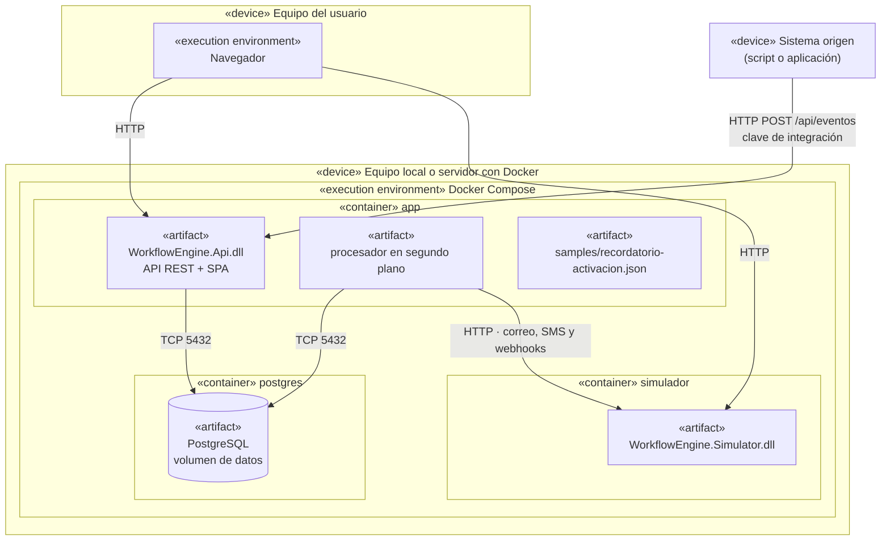

# 7. Despliegue

Convenciones: los subgrafos son nodos «device» o «execution environment»; los rectángulos internos son artefactos desplegados. Una sola instancia de la aplicación (ADR-01). La topología es la misma en una máquina local o en un servidor.

| Elemento | Notas |
|---|---|
| `app` | Un proceso: API, SPA en el mismo origen (cookie, ADR-08) y procesador en segundo plano. Configuración: cadena de conexión, URL del simulador, cuentas iniciales con su rol y clave de integración (como secretos, nunca en el repositorio). Al arrancar siembra las cuentas e instala el flujo de ejemplo (RF-19). |
| `simulador` | Aplicación aparte; solo se comunica por HTTP (AR-16). Su interfaz indica que es una simulación (CA-90f). |
| `postgres` | Único estado del sistema; un volumen para que sobreviva a `docker compose down`. |
| Instalación | `docker compose up` siguiendo el README, en 15 min o menos (CA-N14a). |

**Pruebas automáticas (CI).** `dotnet test` levanta la aplicación y el simulador en memoria (`WebApplicationFactory`) con `FakeTimeProvider` y un PostgreSQL de prueba en contenedor (Testcontainers), sin red externa (CA-N08c). Las pruebas del editor usan Playwright contra `docker compose`.
