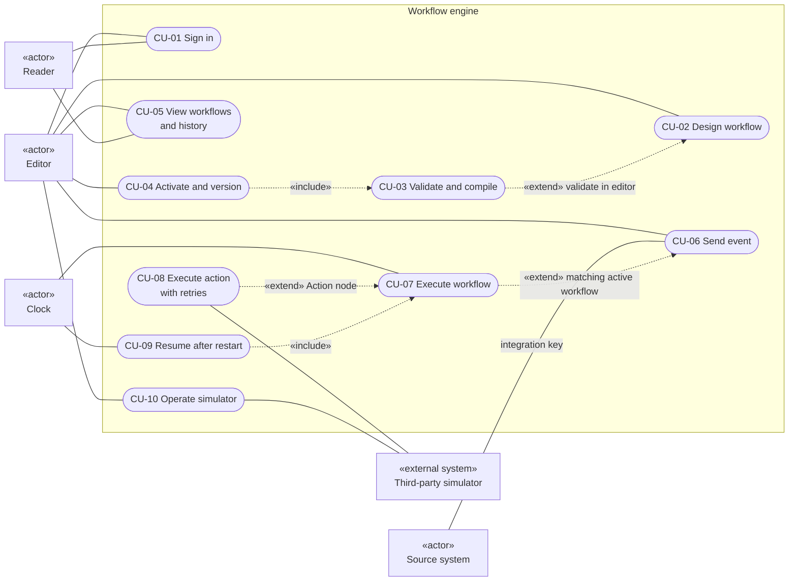

# 1. Use cases

Conventions: actors are “actor” rectangles, use cases are ovals, and the large rectangle is the system boundary. “include” always happens; “extend” happens when its condition holds. Stable `CU` IDs are shared across languages.

## Catalog

| CU | Name | Primary actor | Requirements | Key |
|---|---|---|---|---|
| CU-01 | Sign in and out | Editor, Reader | RF-30 | |
| CU-02 | Design workflow in editor | Editor | RF-01, RF-40 | A |
| CU-03 | Validate and compile workflow | Editor | RF-02, RF-14 | A |
| CU-04 | Activate and version workflow | Editor | RF-03 | A |
| CU-05 | View workflows and history | Editor, Reader | RF-12, RF-18, CA-30e | |
| CU-06 | Send event | Source system, Editor (test) | RF-04, CA-30d | B |
| CU-07 | Execute workflow | Clock | RF-05, RF-07, RF-11, RF-13, RF-18 | B |
| CU-08 | Execute action with retries | (extends CU-07) | RF-06, RF-09, RF-16 | B |
| CU-09 | Resume after restart | Clock | RF-10, RF-11 | C |
| CU-10 | Operate simulator | Editor | RF-90, RF-91 | |

All Editor/Reader cases except CU-10 require a session (CU-01). The simulator represents external services and requires no sign-in. Readers only view (CA-30b). **Clock** represents time passing: a wait expires or the system restarts.

## Diagram

## Key use cases

**A · Design, validate and activate (CU-02 through CU-04).** A signed-in Editor drags Event, Condition, Action and Timer nodes, connects them, edits parameters and saves. Activation validates RN-10 and returns all errors; valid diagrams compile to a deterministic DAG and create a version. Alternatives: invalid workflows keep their state (CA-03a); reject Reader attempts (CA-30b). Criteria: CA-02a–d, CA-02f–i, CA-14a–d, CA-03a–d, CA-40a–f.

**B · Execute (CU-06 through CU-08).** An event with the integration key creates one execution per matching active workflow. The worker claims it and the interpreter advances through the DAG: Timer becomes Waiting, Condition chooses “yes”/“no”, Action calls the simulator with a unique reference. Network errors, 10 s timeouts and 5xx responses retry after 1, 5 and 30 min. Alternatives: invalid key rejects the event (CA-30d); exhausted retries, 4xx or missing variables cause Failed. Criteria: CA-04a–d, CA-05a/b, CA-06a, CA-06e–g, CA-07a, CA-09a/b, CA-16a–g, CA-19b/c.

**C · Resume (CU-09).** After a crash, the worker claims due waits and executions with expired leases, continuing from the current node without repeating recorded steps. Repeat unconfirmed deliveries with the same reference; the simulator discards duplicates. Criteria: CA-10a–c, CA-11a/b, CA-13c.
