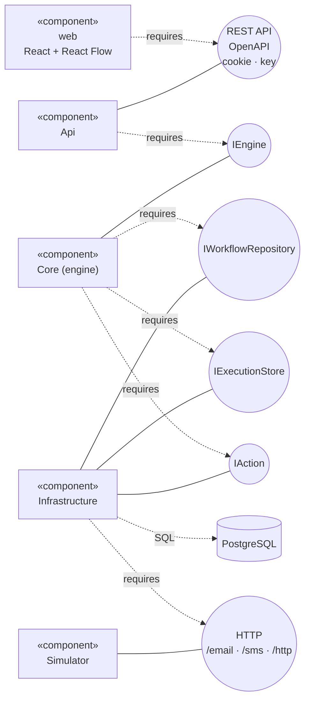

# 2. Components

Conventions: “component” rectangles are solution projects (ADR-07); circles are interfaces. Solid lines mean **provides**, dashed arrows mean **requires**.

| Component | Responsibility |
|---|---|
| `web` | Sign-in, node editor (read-only for Reader), execution history and test events. OpenAPI-generated client (ADR-08). |
| `Api` | `/api/session`, `/api/workflows`, `/api/events`, `/api/executions`; ASP.NET Core Identity, Editor/Reader policies, event integration key, composition and SPA hosting. |
| `Core` | Validator, DAG compiler, interpreter, state machine, action registry and port definitions. No database/HTTP knowledge (AR-01). |
| `Infrastructure` | EF Core/PostgreSQL, background worker (`SKIP LOCKED` claims) and three HTTP actions (ADR-03, ADR-05). |
| `Simulator` | Email, SMS and HTTP POST receivers, configurable responses and failure injection. Separate application (ADR-15). |

Infrastructure also hosts installed service adapters, the isolated local runner and durable artifact storage. Api enforces owner access to connections and artifacts. Core consumes the versioned catalog and typed outputs (ADR-100, ADR-101).
