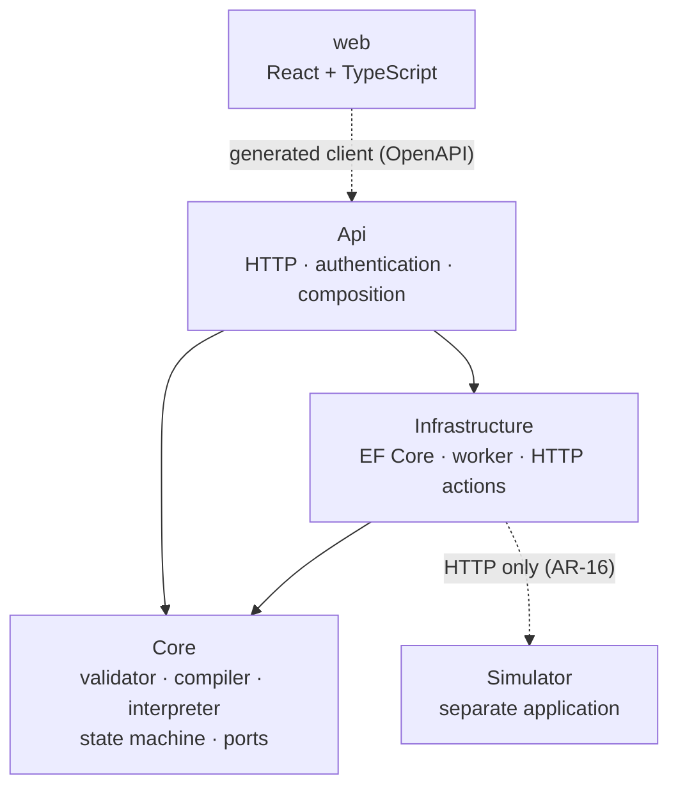
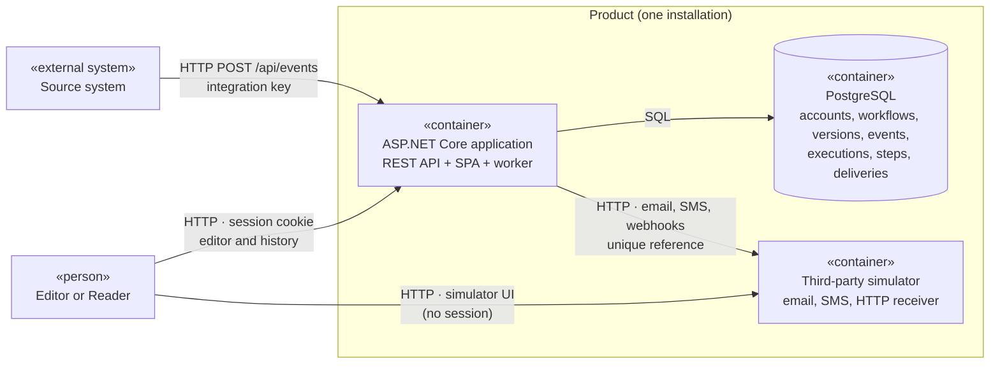
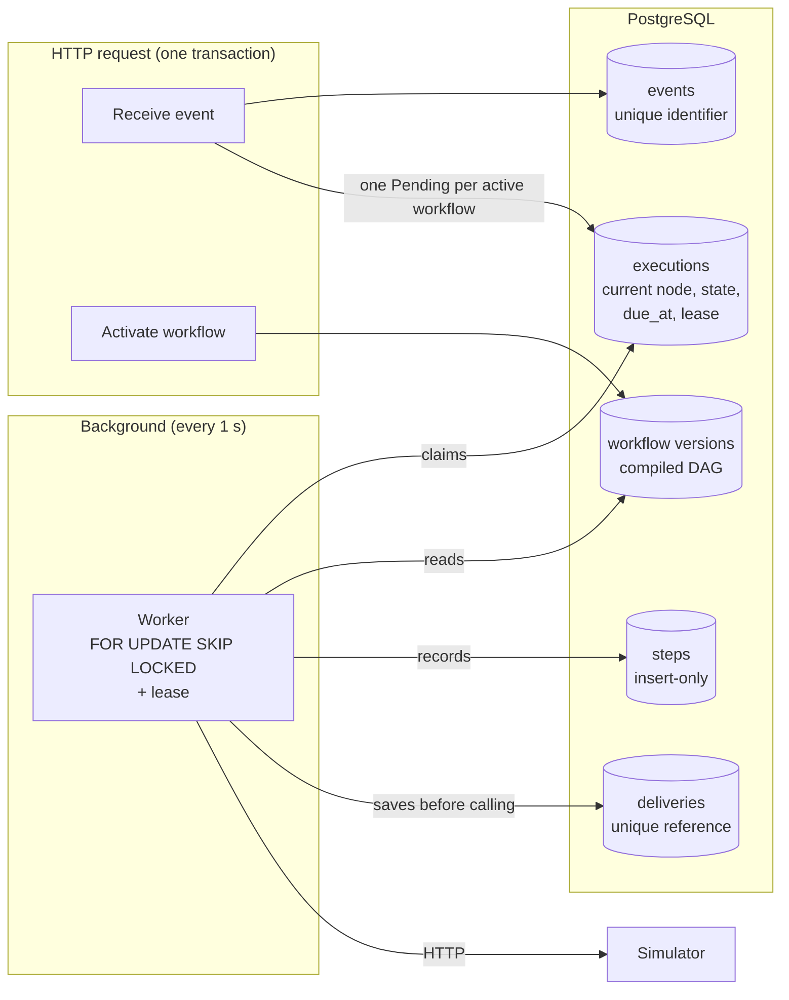
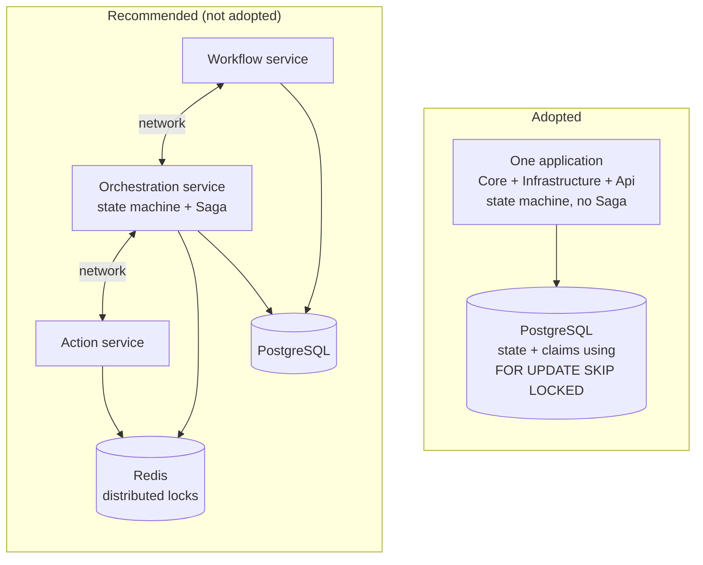

# 3. Architecture

## 3.1 Modules and allowed dependencies (ADR-07)

| Rule | Prevents |
|---|---|
| AR-01 | `Core` knowing `Infrastructure`, `Api`, EF Core, ASP.NET Core or HTTP |
| AR-04 | Third-party HTTP clients outside `Infrastructure` |
| AR-16 | Project references to `Simulator` |
| AR-17 | Passing diagrams instead of compiled DAGs to the interpreter |
| AR-18 | Execution state changes outside the state machine |

## 3.2 Containers

## 3.3 Synchronous and asynchronous processing

HTTP requests only **record** facts in a transaction. A background worker reads database tables to handle time and third-party calls, so crashes do not lose work (ADR-03).

## 3.4 Recommended versus adopted architecture (ADR-18)

The left side interprets the assignment's recommendation; the right side shows what will be built. ADR-18 explains each omitted component.

