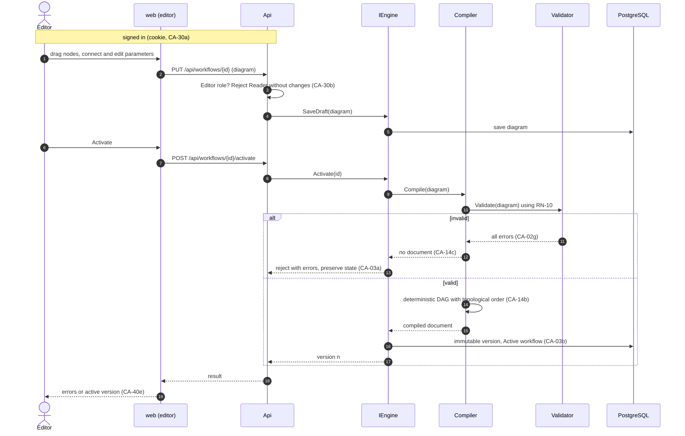
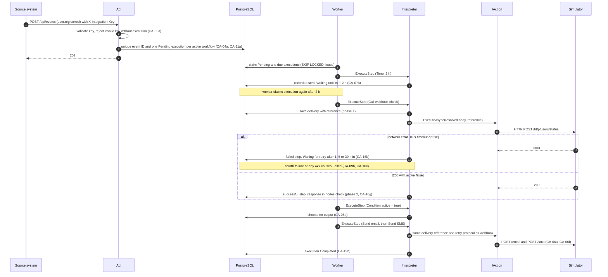
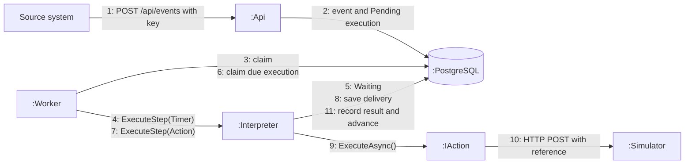
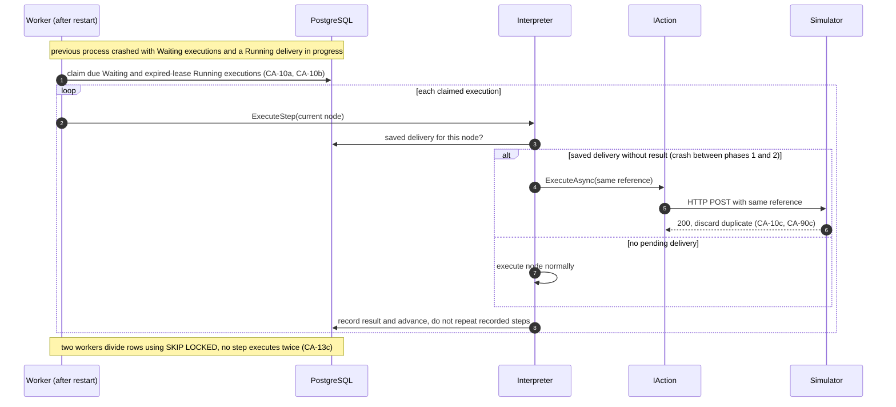

# 6. Sequence and communication

Simplified views of the three key use cases ([01-use-cases.md](01-use-cases.md)). B uses the assignment example (RF-19).

## A · Design, validate and activate (CU-02 through CU-04)

## B · Execute a workflow (CU-06 through CU-08)

### Sequence

### Communication

Subsequent nodes (Condition, email and SMS) repeat 7 through 11.

## C · Resume after restart (CU-09)

