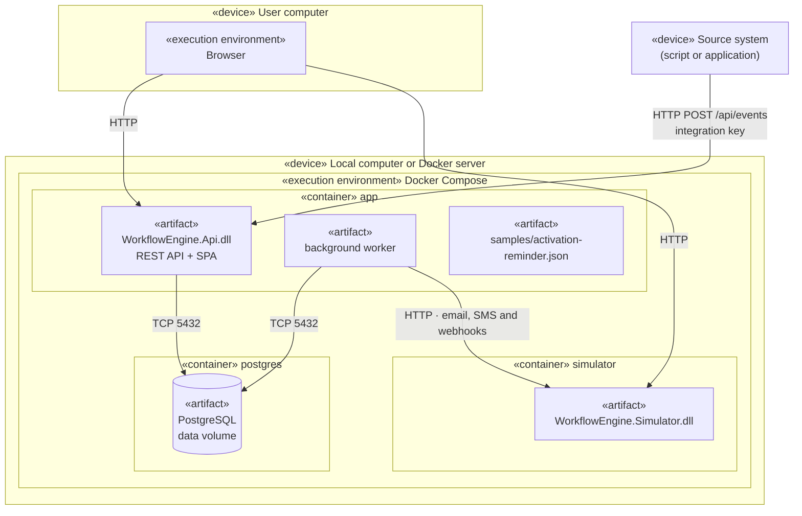

# 7. Deployment

Conventions: subgraphs are “device” or “execution environment” nodes; inner rectangles are deployed artifacts. One application instance (ADR-01). The topology is the same locally and on a server.

| Element | Notes |
|---|---|
| `app` | One process: API, same-origin SPA (cookie, ADR-08) and background worker. Configuration: connection string, simulator URL, initial accounts/roles and integration key (secrets, never committed). Startup seeds accounts and installs the example workflow (RF-19). |
| `simulator` | Separate application; HTTP communication only (AR-16). UI identifies it as a simulation (CA-90f). |
| `postgres` | The system's only state store; a volume preserves data through `docker compose down`. |
| Installation | `docker compose up` following the README, within 15 min (CA-N14a). |

**Automated tests (CI).** `dotnet test` hosts the app and simulator in memory (`WebApplicationFactory`) with `FakeTimeProvider` and a PostgreSQL test container (Testcontainers), without external networking (CA-N08c). Editor tests use Playwright against `docker compose`.
