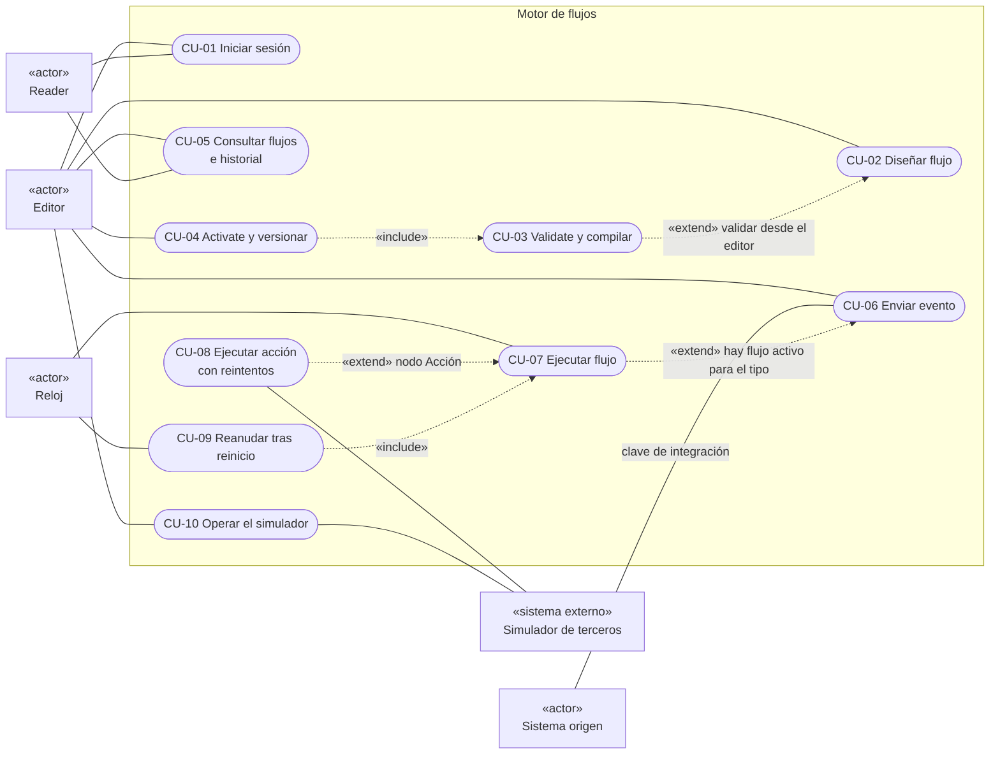

# 1. Casos de uso

Convenciones: los actores son rectángulos «actor», los casos de uso son óvalos y el rectángulo grande es el límite del sistema. «include» siempre ocurre; «extend» ocurre si se cumple su condición.

## Catálogo

| CU | Nombre | Actor primario | Requisitos | Clave |
|---|---|---|---|---|
| CU-01 | Iniciar y cerrar sesión | Editor, Lector | RF-30 | |
| CU-02 | Diseñar flujo en el editor | Editor | RF-01, RF-40 | A |
| CU-03 | Validar y compilar flujo | Editor | RF-02, RF-14 | A |
| CU-04 | Activar y versionar flujo | Editor | RF-03 | A |
| CU-05 | Consultar flujos e historial | Editor, Lector | RF-12, RF-18, CA-30e | |
| CU-06 | Enviar evento | Sistema origen, Editor (prueba) | RF-04, CA-30d | B |
| CU-07 | Ejecutar flujo | Reloj | RF-05, RF-07, RF-11, RF-13, RF-18 | B |
| CU-08 | Ejecutar acción con reintentos | (extiende CU-07) | RF-06, RF-09, RF-16 | B |
| CU-09 | Reanudar tras un reinicio | Reloj | RF-10, RF-11 | C |
| CU-10 | Operar el simulador | Editor | RF-90, RF-91 | |

Todos los CU del Editor y del Lector, salvo CU-10, exigen sesión (CU-01); el simulador no la exige porque representa a servicios externos. El Lector solo consulta (CA-30b). El **Reloj** representa el paso del tiempo: vence una espera o se reinicia el sistema.

## Diagrama

## Fichas de los CU clave

**A · Diseñar, validar y activar un flujo (CU-02 a CU-04).** El Editor, con sesión, arrastra nodos Evento, Condición, Acción y Temporizador, los conecta, edita sus parámetros y guarda. Al activar, el sistema valida según RN-10 y devuelve todos los errores; si es válido, compila un DAG determinista y crea una versión. Alternativas: inválido, el flujo no cambia de estado (CA-03a); un Lector lo intenta, se rechaza (CA-30b). Criterios: CA-02a–d, CA-02f–i, CA-14a–d, CA-03a–d, CA-40a–f.

**B · Ejecutar un flujo (CU-06 a CU-08).** Llega un evento con la clave de integración; se crea una ejecución por cada flujo activo con ese tipo. El procesador la reclama y el intérprete avanza nodo a nodo sobre el DAG: el Temporizador la deja Esperando; la Condición elige «sí» o «no»; la Acción llama al simulador con referencia única y, ante fallo de red, 10 s agotados o 5xx, reintenta a 1, 5 y 30 min. Alternativas: sin clave válida, el evento se rechaza (CA-30d); reintentos agotados, 4xx o variable sin valor, la ejecución queda Fallida. Criterios: CA-04a–d, CA-05a/b, CA-06a, CA-06e–g, CA-07a, CA-09a/b, CA-16a–g, CA-19b/c.

**C · Reanudar tras un reinicio (CU-09).** Tras una caída, el procesador reclama las esperas vencidas y las ejecuciones con concesión expirada, y continúa desde el nodo actual sin repetir pasos. Un envío a medio confirmar se repite con la misma referencia y el simulador descarta el duplicado. Criterios: CA-10a–c, CA-11a/b, CA-13c.
