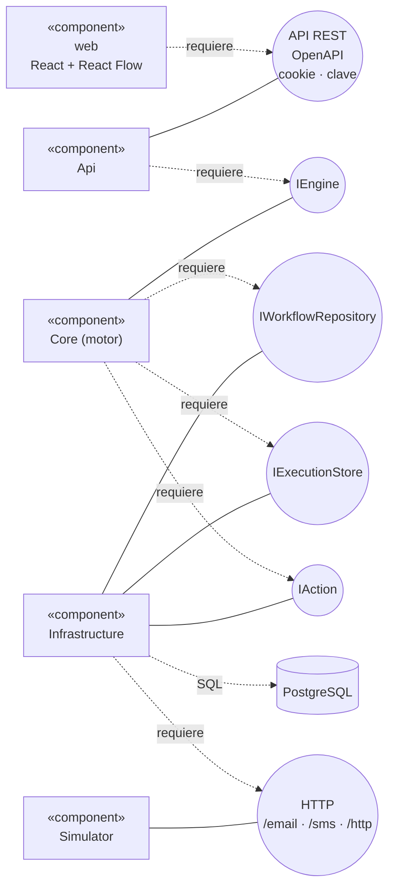

# 2. Componentes

Convenciones: los rectángulos «component» son proyectos de la solución (ADR-07); los círculos son interfaces. Línea continua: el componente **provee** la interfaz. Flecha discontinua: el componente la **requiere**.

| Componente | Responsabilidad |
|---|---|
| `web` | Inicio de sesión, editor de nodos (en solo lectura para el Lector), historial de ejecuciones y envío de eventos de prueba. Cliente generado desde OpenAPI (ADR-08). |
| `Api` | Recursos `/api/session`, `/api/workflows`, `/api/events` y `/api/executions`; autenticación con ASP.NET Core Identity, políticas por rol (Editor y Lector) y clave de integración para eventos; composición; sirve la SPA. |
| `Core` | Validador, compilador a DAG, intérprete, máquina de estados y registro de acciones. Define los puertos. No conoce base de datos ni HTTP (AR-01). |
| `Infrastructure` | EF Core sobre PostgreSQL, procesador en segundo plano (reclamo con `SKIP LOCKED`) y las tres acciones HTTP (ADR-03, ADR-05). |
| `Simulator` | Receptores de correo, SMS y HTTP POST, respuestas configurables e inyección de fallos. Aplicación aparte (ADR-15). |

Infrastructure también aloja los adaptadores instalados, el ejecutor local aislado y el almacenamiento duradero de artefactos. Api comprueba la titularidad al acceder a conexiones y artefactos. Core consume el catálogo versionado y salidas tipadas (ADR-100, ADR-101).
