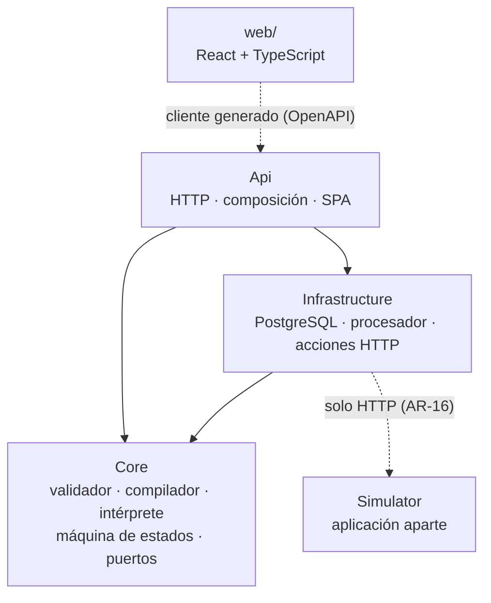
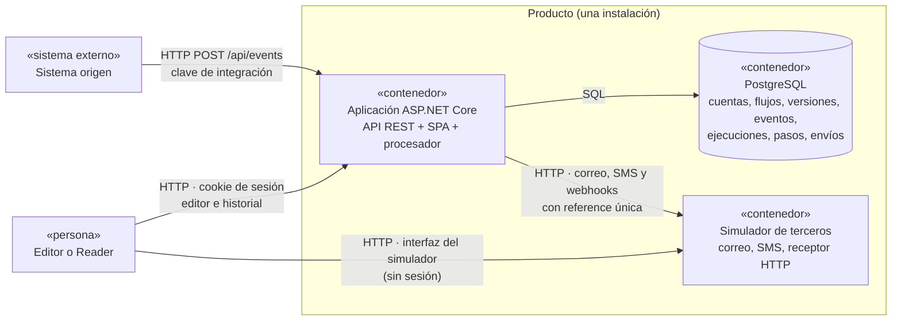
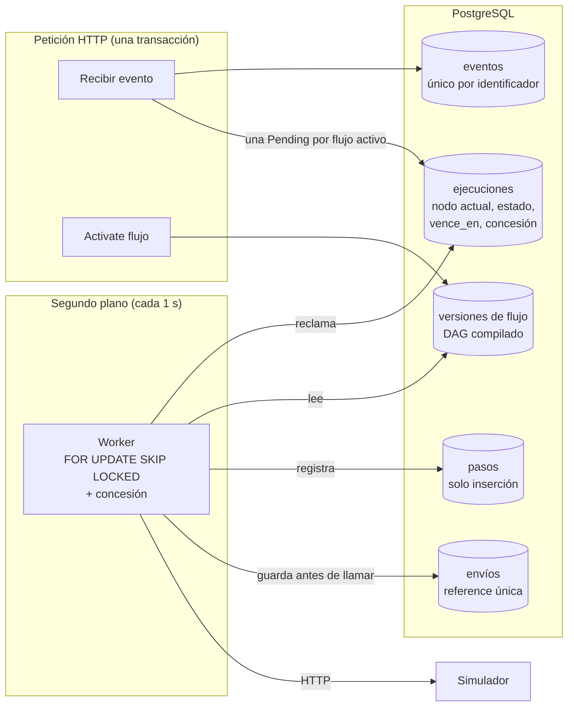
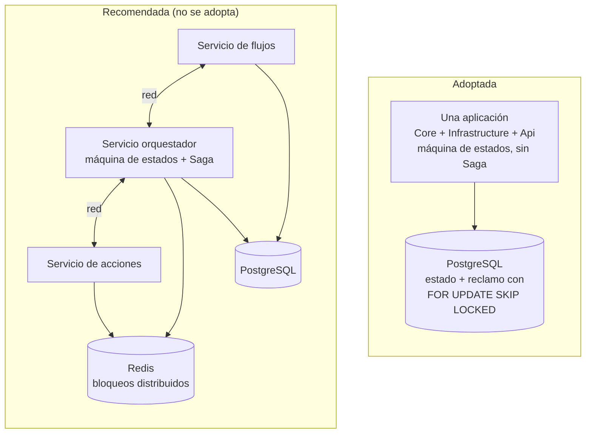

# 3. Arquitectura

Monolito modular con un solo despliegue (ADR-01), estado durable en PostgreSQL (ADR-03) y terceros simulados por HTTP (ADR-15). La arquitectura recomendada por el enunciado no se adopta (ADR-18, vista 3.4).

## 3.1 Módulos y dependencias permitidas (ADR-07)

Las flechas continuas son referencias de proyecto permitidas. Lo que no tiene flecha está prohibido y lo comprueban las reglas AR.

| Regla | Qué impide |
|---|---|
| AR-01 | Que `Core` conozca `Infrastructure`, `Api`, EF Core, ASP.NET Core o HTTP |
| AR-04 | Clientes HTTP hacia terceros fuera de `Infrastructure` |
| AR-16 | Referencias de proyecto a `Simulator` |
| AR-17 | Que el intérprete reciba el diagrama en vez del DAG compilado |
| AR-18 | Cambios de estado de una ejecución fuera de la máquina de estados |

## 3.2 Contenedores

## 3.3 Procesamiento síncrono y asíncrono

Las peticiones HTTP solo **registran** hechos en una transacción. El trabajo con tiempo y con terceros lo hace un procesador en segundo plano que lee de tablas, así que una caída no pierde nada (ADR-03).

## 3.4 Arquitectura recomendada frente a la adoptada (ADR-18)

A la izquierda, una lectura de lo que recomienda el enunciado. A la derecha, lo que se construye. Cada pieza de la izquierda que no aparece a la derecha se justifica en ADR-18.

