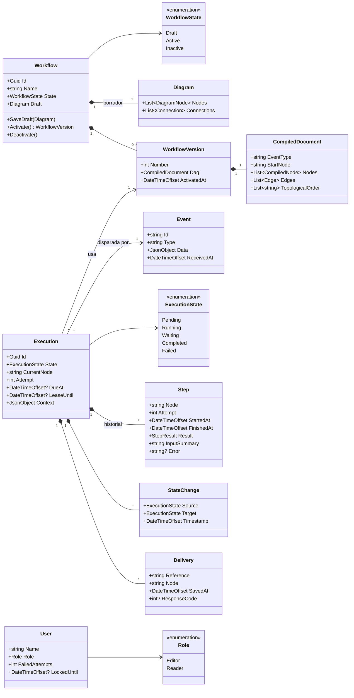
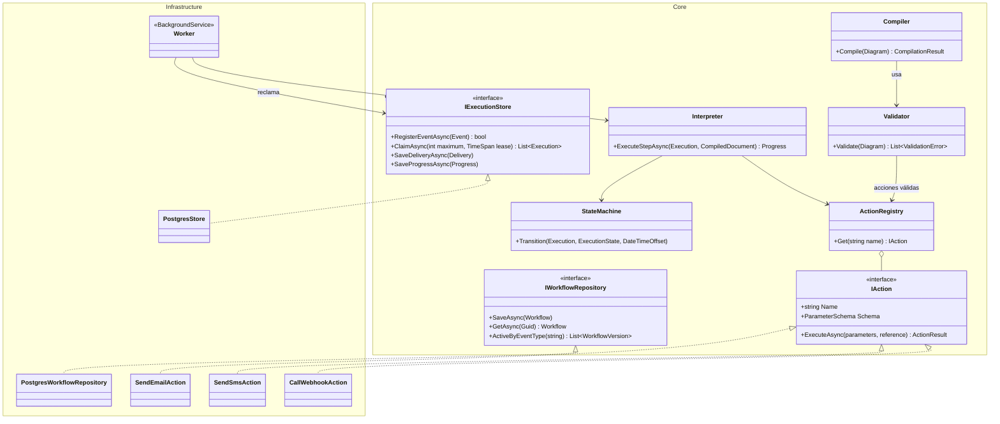

# 4. Clases

Modelo de dominio y puertos, no clases de implementación. Los identificadores de código usan inglés. `User` lo gestiona ASP.NET Core Identity en `Api` (ADR-08); `Core` no lo conoce.

## 4.1 Modelo

## 4.2 Motor y puertos

`ActionResult` es **Success** (con código y cuerpo), **Retryable** o **PermanentFailure** (RN-29). `Progress` reúne lo que un paso confirma en una sola transacción: el paso registrado, el nuevo estado, el siguiente nodo o el instante de la espera, y la respuesta que se agrega al contexto (ADR-03).
