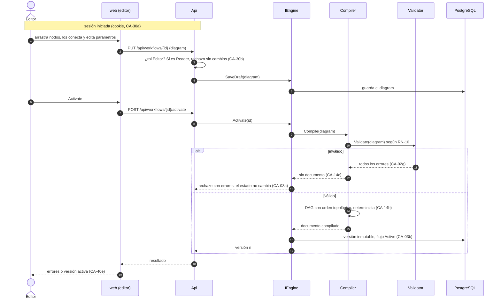
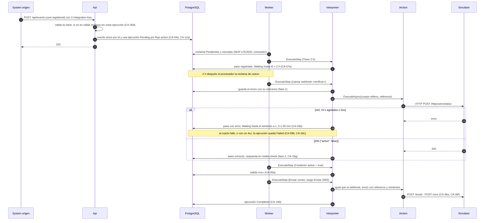
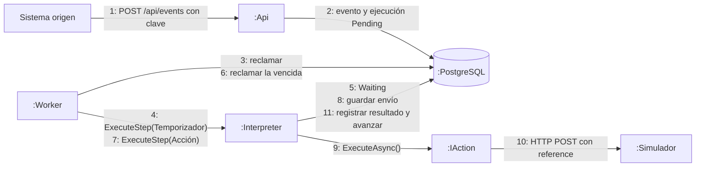
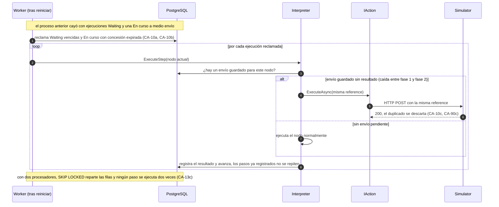
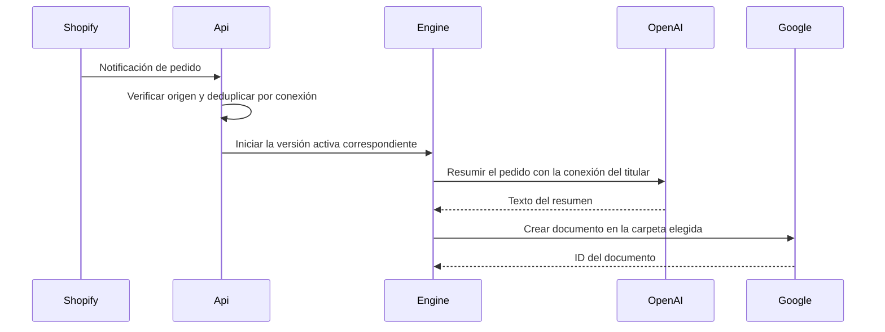

# 6. Secuencia y comunicación

Vistas simplificadas de los tres CU clave ([01-use-cases.md](01-use-cases.md)). B usa el flujo de ejemplo del enunciado (RF-19).

## A · Diseñar, validar y activar un flujo (CU-02 a CU-04)

## B · Ejecutar un flujo (CU-06 a CU-08)

### Secuencia

### Comunicación

Los nodos siguientes (Condición, correo y SMS) repiten 7 a 11.

## C · Reanudar tras un reinicio (CU-09)

## Conexiones personales (RF-100)

El titular configura las tres operaciones versionadas y la carpeta de destino antes de activar el flujo.

